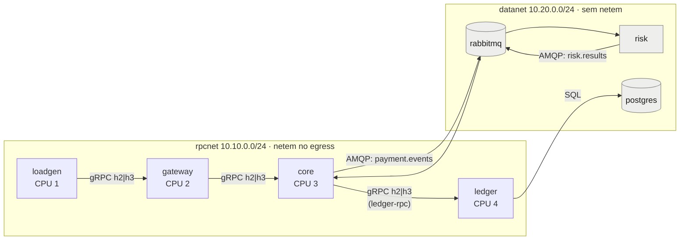
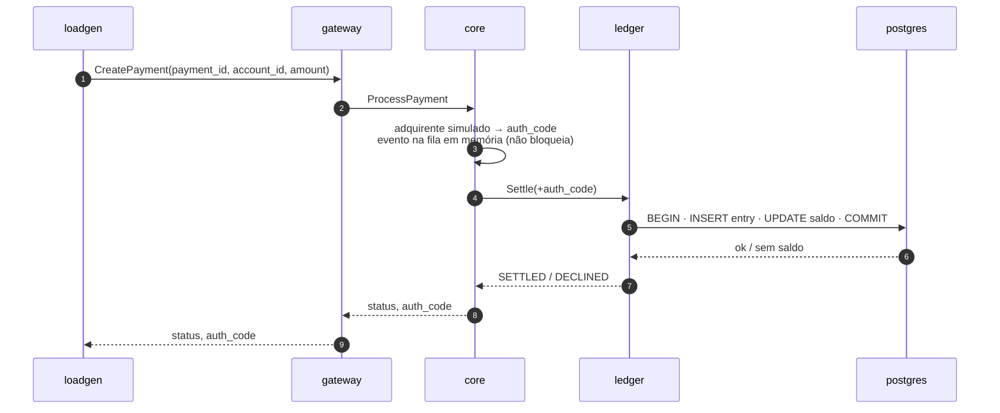
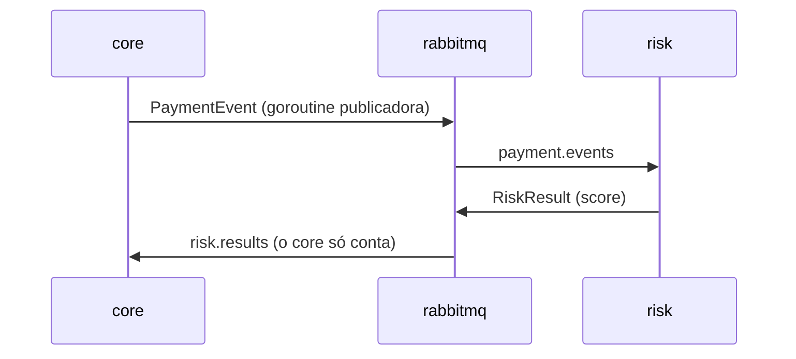

# Arquitetura — gateway de pagamentos com gRPC sobre HTTP/2 (TCP) e HTTP/3 (QUIC)

Este documento explica como o sistema e a bancada de testes estão montados e como ler os números que eles produzem. As decisões e os critérios estão na spec, [`plan/payment-plan.md`](plan/payment-plan.md); os resultados, em [`PAYMENT-RUN-ANALYSIS.md`](PAYMENT-RUN-ANALYSIS.md).

**Conteúdo**

1. [Visão geral](#1-visão-geral)
2. [Estrutura do projeto](#2-estrutura-do-projeto)
3. [Transporte e serviços em Go](#3-transporte-e-serviços-em-go)
4. [Fluxos de um pagamento](#4-fluxos-de-um-pagamento)
5. [Gerador de carga](#5-gerador-de-carga)
6. [Fluxo do experimento](#6-fluxo-do-experimento)
7. [Métricas](#7-métricas)
8. [Comandos](#8-comandos)

---

## 1. Visão geral

Um gateway de pagamentos em microsserviços (TCC §3.3) em que **um único parâmetro, `TRANSPORT=h2|h3`, troca o transporte de todos os saltos gRPC síncronos**:

| | h2 | h3 |
|---|---|---|
| HTTP | HTTP/2 | HTTP/3 |
| Segurança | TLS 1.3 | TLS 1.3 (dentro do QUIC) |
| Transporte | TCP | QUIC sobre UDP |
| Biblioteca Go | `net/http` nativo | `quic-go/http3` |

Todo o resto é idêntico nos dois modos: o mesmo código, o mesmo certificado, os mesmos limites e timeouts (§3.2) e **uma conexão por par cliente → servidor**. Uma repetição com mais de uma conexão em qualquer salto é descartada.



*Cinza: Postgres, RabbitMQ e Risk dividem o núcleo 5. O host fica com o núcleo 0.*

- **Saltos medidos:** loadgen → gateway, gateway → core e core → ledger. Cada um tem uma conexão `transport.Client`, com o protocolo servido conferido em toda resposta.
- **Fora da comparação:** o caminho assíncrono (AMQP) e o SQL usam TCP nos dois modos, numa rede sem falhas injetadas.
- **Fan-out 1:** cada pagamento gera exatamente uma RPC em cada salto, sem novas tentativas.
- **Prazo:** só o loadgen define o prazo (2 s). O connect-go o propaga em cada salto pelo header `grpc-timeout`, e o ledger o repassa às consultas do Postgres.

---

## 2. Estrutura do projeto

```text
.
├── proto/payment/v1/payment.proto  contrato: PaymentService, CoreService, LedgerService, eventos AMQP
├── gen/payment/v1/…                código gerado pelo buf (versionado)
├── cmd/
│   ├── gateway/ core/ ledger/      serviços gRPC (+ subcomando healthcheck)
│   ├── risk/                       consumidor AMQP
│   └── loadgen/                    gerador de carga
├── internal/
│   ├── transport/                  h2/h3 atrás de uma API única
│   ├── service/                    flags com env, logger, Listen + /healthz, clientes, relatório svc-<nome>.json
│   ├── payment/                    validação comum dos pedidos
│   ├── gateway/ core/ ledger/      lógica de cada serviço (handlers, Store do ledger, fila de eventos do core)
│   ├── risk/ broker/               pontuação e AMQP
│   ├── rpclog/                     interceptor de log por RPC
│   └── loadgen/                    runner, recorder (CSV) e meta.json
├── deploy/
│   ├── Dockerfile                  targets services, loadgen e analysis
│   ├── compose.yaml                serviços, redes, cpusets, healthchecks
│   ├── netem.sh                    injeção de falhas (entrypoint dos serviços)
│   └── postgres/init.sql           schema + 10.000 contas
├── experiments/scenarios/*.env     um arquivo por cenário (netem + carga)
├── scripts/                        gen-certs.sh, host-tuning.sh, run.sh (runner)
├── analysis/                       analyze.py, calibrate.py, fitness.py, timeline.py + testes
└── doc/                            spec, plano, resultados, este documento; archive/poc/ guarda o POC
```

---

## 3. Transporte e serviços em Go

**Versões:** Go 1.27.1, connect-go v1.21.0, quic-go v0.63.0, protobuf v1.36.12, pgx v5.11.0, amqp091-go v1.15.0; PostgreSQL 18.6 e RabbitMQ 4.3.6.

### 3.1 Duas pilhas atrás de uma API (`internal/transport`)

- **`Listen(cfg, handler, log)`** valida a config, carrega o TLS e abre o socket: TCP servido por `http.Server` no h2, UDP servido por `http3.Server` no h3. **`Serve(ctx)`** bloqueia até o contexto acabar e faz o shutdown graceful.
- **`NewClient(cfg)`** devolve um cliente que satisfaz o `connect.HTTPClient` e mantém uma conexão por host. `Dials()` conta as conexões abertas.
- **Header `x-served-proto`:** toda resposta leva o protocolo realmente usado. O cliente confere em toda resposta, então nunca há fallback silencioso de HTTP/3 para HTTP/2.
- **Uma conexão por par:** no h2, `StrictMaxConcurrentRequests` impede uma segunda conexão quando o limite de streams enche, e `MaxConnsPerHost: 1` serializa os dials. O `http3.Transport` já usa uma conexão por host.

### 3.2 Parâmetros simétricos

| Parâmetro | Valor | h2 | h3 |
|---|---|---|---|
| Streams por conexão | 1000 | `HTTP2Config.MaxConcurrentStreams` | `QUICConfig.MaxIncomingStreams` |
| Timeout de handshake | 5 s | timeout no `DialTLSContext` | `HandshakeIdleTimeout` |
| Idle | 30 s | `IdleTimeout` | `MaxIdleTimeout` |
| Keepalive de aplicação | desligado | — | — |
| TLS | 1.3, mesmo certificado | `tls.Config` | `tls.Config` |
| Compressão | desligada | gzip não registrado | idem |

Com mais RPCs em voo do que o limite de streams, o cliente h2 do Go trava; por isso o fan-out é 1 e o loadgen usa no máximo 500 workers.

### 3.3 Os serviços

| Serviço | Faz | Fala com |
|---|---|---|
| **gateway** | valida o pedido e o repassa ao core | loadgen (servidor), core (cliente) |
| **core** | valida, autoriza com o adquirente simulado (código de 6 caracteres derivado do `payment_id`, atraso `ACQUIRER_DELAY`), põe o evento numa fila em memória sem bloquear e chama o ledger | gateway, ledger (`ledger-rpc`), RabbitMQ |
| **ledger** | numa transação: insere o lançamento com o `payment_id` como chave (idempotência) e debita a conta só se o saldo cobrir; sem saldo, devolve `DECLINED` | core, Postgres |
| **risk** | consome `payment.events`, calcula um score determinístico e publica em `risk.results` | RabbitMQ |

- **Molde comum (`internal/service`):** configuração por flag > variável de ambiente > padrão, logger JSON, `Listen` com `/healthz`, clientes com gRPC, sem gzip, `rpclog` e checagem do protocolo servido, e um relatório `svc-<nome>.json` gravado no shutdown, com as conexões por salto e os contadores.
- **`ledger-rpc`:** o ledger está nas duas redes, e o nome `ledger` pode resolver para o IP da `datanet`, onde não há netem. O core usa o alias `ledger-rpc`, que só existe na `rpcnet`.
- **Logs (`internal/rpclog` e passos de domínio):** em `debug`, cada RPC gera uma linha com `side`, `procedure`, `code`, `duration_us`, `protocol` (protocolo RPC, `grpc`), `payment_id` e, no lado cliente, `http` (versão servida). Cada serviço também loga os passos do pagamento. Em `info` (padrão das medições), tudo isso custa uma checagem de nível.

---

## 4. Fluxos de um pagamento

### 4.1 Síncrono



Um erro em qualquer salto volta ao cliente com o código gRPC original. Prazo vencido vira `deadline_exceeded`; salto fora do ar, `unavailable`.

### 4.2 Assíncrono



- **Fora do caminho medido:** o evento é publicado depois de o pagamento seguir. Se a fila em memória (10.000) encher, o evento é descartado e contado em `events_dropped`.
- **Filas:** duráveis, com mensagens transitórias.
- **Broker perdido:** core e risk saem com código ≠ 0, e a repetição falha de forma visível.

---

## 5. Gerador de carga

- **Carga em taxa fixa:** agenda global `t_k = t0 + k/rps`. A latência é medida desde `t_k`, então a espera por um worker livre entra na conta. Isso evita a *coordinated omission*.
- **Pedido:** `payment_id` aleatório (32 caracteres hex), conta uniforme em 1..10.000, valor de 1000 centavos. O pedido tem ~40 B e a resposta ~44 B.
- **Probe:** antes da carga, uma RPC atravessa a cadeia, abre as 3 conexões em série e confere o protocolo servido. O `handshake_us` é a duração do probe.
- **Recorder:** uma goroutine grava o `requests.csv` a partir de um canal com buffer de 65.536; com o buffer cheio, o worker espera, e isso é contado em `recorder_stalls`.
- **Aquecimento:** as linhas do aquecimento ficam no CSV com `phase=warmup`, e a análise as ignora.
- **`late_starts`:** slots que começaram mais de 1 ms depois do planejado. Na VM, ficam em 4–15% mesmo sem saturação, porque a vCPU demora a acordar o goroutine entre slots. São reportados, mas não decidem nada.

---

## 6. Fluxo do experimento

### 6.1 Uma repetição (`run.sh rep`)

```mermaid
sequenceDiagram
  autonumber
  participant R as run.sh
  participant DC as docker compose
  participant ST as docker stats
  participant LG as loadgen
  R->>R: carrega o .env do cenário; REP_DIR=/results/<rep>
  R->>DC: up -d --wait gateway risk (sobe toda a cadeia)
  R->>ST: amostragem em background → stats.csv
  opt s5 (OUTAGE_AT)
    R->>DC: depois de OUTAGE_AT s: exec gateway netem.sh outage 5 → events.csv
  end
  R->>DC: run --no-deps loadgen $LOADGEN_ARGS $LOADGEN_EXTRA → requests.csv, meta.json
  R->>R: espera DRAIN_SECS (caminho assíncrono)
  Note over R: trap EXIT
  R->>DC: stop (shutdown → svc-*.json)
  R->>DC: logs de cada serviço → <serviço>.log
  R->>DC: down -v (sem volumes acumulados)
```

- **Matriz (`run.sh` sem argumentos):**
  - percorre cenário × repetição × transporte, alternando a ordem h2/h3 a cada repetição;
  - uma falha de probe é repetida uma vez (`probe-failed-rep-N`); outras falhas vão para o `failures.log`;
  - a pasta da rodada é o horário local (com `RUN_PREFIX` opcional) e é imutável.
- **Aptidão do ambiente (`run.sh fitness`, `make fitness`):** uma repetição de s1 com h2 a 250 RPC/s por 30 s. Ela reprova o host quando o `cpu_per_krps` passa de 200 (referência limpa: 134–172). O `make run-all` e o `make calibrate` dependem dela; `FITNESS=0` pula.
- **Trace (`run.sh trace`, `make trace`):** 20 pagamentos com todos os serviços em `debug`, em `results/trace-<horário>/<transporte>/`. O `timeline.py` junta os logs por `payment_id` em `timeline.txt`.
- **Calibração (`make calibrate`, `calibrate.py`):** varredura de taxas no s1 (§9 da spec).

### 6.2 Injeção de falhas (`netem.sh`)

- **Onde atua:** o netem atua no egress da interface da `rpcnet` (escolhida por `NETEM_SUBNET`) do loadgen, do gateway, do core e do ledger. Cada travessia de cada salto sofre o atraso e a perda uma vez por direção; uma RPC atravessa 6 trechos.
- **Rede de dados:** a `datanet` nunca tem netem.

| Cenário | Atraso/lado | Jitter | Perda | Carga | Objetivo |
|---|---|---|---|---|---|
| `s1-baseline` | 0 | 0 | 0% | 300 RPC/s | custo das pilhas sem falhas |
| `s2-loss-{1,3,5}-low` | 5 ms | 0 | 1/3/5% | 200 RPC/s | HoLB do TCP contra streams independentes do QUIC |
| `s3-jitter` | 20 ms | 10 ms (normal) | 0% | 300 RPC/s | variação de atraso, sem reordenação |
| `s5-outage` | 5 ms | 0 | 0% + apagão de 5 s no gateway | 300 RPC/s | tempo de recuperação na mesma conexão |

- **RTT base de ponta a ponta:** 30 ms no s2 e no s5, e 120 ms no s3.
- **Jitter:** o `netem.sh` acrescenta `rate 10gbit`. Sem ele, cada pacote recebe um atraso independente, e pacotes enviados com menos de 1 ms de intervalo chegam fora de ordem. Com `rate`, o netem entrega em ordem (FIFO). Uma fila `pfifo` filha não resolve, porque o netem só entrega os pacotes a ela depois do atraso de cada um.
- **Apagão:** 100% de perda no egress da `rpcnet` do gateway, cortando as respostas ao loadgen e os pedidos ao core. O `OUTAGE_AT=30` conta da subida da pilha, então o apagão cai por volta de 20 s dentro da janela medida. O `events.csv` registra os instantes reais.
- **Taxas:** vêm da calibração (spec §9): capacidade de saturação de 1000 RPC/s; taxa alta de 300 RPC/s, com margem para a variação da VM; taxa baixa de 200 RPC/s, que o h2 atende a 5% de perda.

### 6.3 Árvore de resultados

```text
results/<horário>/
├── failures.log                     só se alguma repetição falhou
├── <cenário>/<h2|h3>/rep-<n>/
│   ├── requests.csv · meta.json · stats.csv · events.csv (s5)
│   ├── svc-gateway.json · svc-core.json · svc-ledger.json · svc-risk.json
│   └── loadgen.log · gateway.log · core.log · ledger.log · risk.log · rabbitmq.log · postgres.log
└── analysis/                        gerado por make analyze
```

---

## 7. Métricas

### 7.1 De onde vêm os dados

- **`requests.csv`:** `seq,worker,start_ns,latency_us,status,req_bytes,resp_bytes,phase`, uma linha por RPC. `start_ns` é o horário planejado; `status` é `ok` ou o código gRPC. Um pagamento recusado (`DECLINED`) entra como `failed_precondition`.
- **`meta.json`:** configuração e contadores do loadgen: `dials`, `interrupted`, `handshake_us`, `late_starts`, `unsent`, `recorder_stalls`, erros por código.
- **`svc-<nome>.json`:** `dials` por salto e contadores: no core, `events_published`, `events_dropped` e `risk_results`; no risk, `events_consumed` e `results_published`.
- **`stats.csv`:** `docker stats` a cada ~2 s. A CPU está em % de 1 vCPU.
- **`events.csv`:** `outage_start` e `outage_end` (Unix ns).

### 7.2 Validade de uma repetição

Uma repetição é descartada pela análise se:
- não tiver `meta.json` ou tiver sido interrompida;
- tiver `dials ≠ 1` no loadgen ou em qualquer salto (`svc-*.json`);
- faltar algum dos quatro `svc-*.json`, ou algum deles estiver ilegível;
- estiver no `failures.log`.

O `analyze` avisa o motivo de cada descarte.

### 7.3 Métricas por repetição (`reps.csv`)

| Métrica | Cálculo | Leitura |
|---|---|---|
| `p50` … `p999` | percentis da latência das RPCs `ok` | p50 é o caso típico; p99 e p99.9, a cauda |
| `p50_all` … `p999_all` | todos os slots: erros por `max(latência, prazo)`, slots não enviados pelo prazo | sem viés de sobrevivência; só valem sem saturação |
| `ok_rps` · `served_frac` | vazão `ok`; `ok ÷ (rps × duração)` | `served_frac` < 1 indica saturação |
| `error_rate` | RPCs ≠ `ok` ÷ total | |
| `handshake_ms` | duração do probe | abrir os 3 saltos em série: h2 ≈ 9 RTTs de salto, h3 ≈ 6 |
| `<contêiner>_cpu` · `_mem_mib` | média do `docker stats` na janela medida | |
| `rpc_cpu` · `cpu_per_krps` | CPU de gateway + core + ledger; por 1000 RPC/s | custo de cada pilha por RPC |
| `recovery_s` (s5) | segundos do fim do apagão até a vazão `ok` ficar ≥ 90% da média anterior por 3 janelas seguidas | resolução de 1 s |
| `degraded_s` | bins de 1 s, fora do apagão, com vazão `ok` < 90% da taxa | engasgos de vazão; em s1 e s5, ruído de host |
| `cpu_outlier` | `cpu_per_krps` acima da mediana + 3 MAD do grupo **e** ≥ 20% acima da mediana | ruído de host numa repetição isolada |

`--exclude-degraded=<cenários>` tira do resumo as repetições com `degraded_s > 0` ou `cpu_outlier` nos cenários indicados (só os sem falha injetada: `s1-baseline`, `s5-outage`). O `reps.csv` mantém todas.

### 7.4 Agregação e estatística

| Saída | Conteúdo |
|---|---|
| `summary.csv` | por cenário × transporte: média e IC 95% (t de Student), mediana com IC por estatísticas de ordem, `n`, `n_excluded`, `cv_p50` |
| `comparison.csv` | por cenário × métrica: medianas, deslocamento de Hodges–Lehmann h3 − h2 com IC exato, delta de Cliff, Mann-Whitney U com correção de Holm por cenário, razão h3/h2 com IC para a vazão |
| gráficos | `latency_cdf.png`, `p99_boxplot.png`, `s5_throughput.png` |

**Como ler:**
- No texto, use a mediana, o HL com IC e o δ de Cliff; o p de Holm entra só como confirmação.
- **|δ| ≥ 0,474** é efeito grande.
- Com muitas repetições, diferenças de microssegundos ficam significativas, então discuta o tamanho do efeito, não só o p.

---

## 8. Comandos

| Comando (na VM) | Faz |
|---|---|
| `sudo bash scripts/host-tuning.sh` | uma vez por boot: buffers UDP e módulo `sch_netem` |
| `make certs` | CA e certificado com os nomes `gateway`, `core`, `ledger`, `ledger-rpc` e `localhost` |
| `make build` | imagens `services` e `loadgen` |
| `make test` · `make test-db` · `make test-py` | testes Go com `-race`; testes do `PgStore` contra o Postgres do compose; pytest |
| `make smoke TRANSPORT=h2\|h3` | 1000 pagamentos com `--strict`; imprime a contagem de lançamentos |
| `make trace TRANSPORT=… [SCENARIO=…]` | 20 pagamentos em `debug` e `timeline.txt` |
| `make fitness` | reprova o host degradado |
| `make calibrate [RATES=…]` | varredura de taxas e relatório (`calibrate.py`) |
| `REPS=30 make run-all [SCENARIOS=…]` | a matriz, depois do `make fitness` |
| `make analyze RUN="<pasta> …" [OUT=…] [EXCLUDE=…]` | análise de uma ou mais rodadas |
| `QLOG=1 …` | diagnóstico: qlog de todos os endpoints QUIC e `nstat` do gateway (custa CPU; não usar nas medições) |

No Windows rodam apenas `go build ./...`, `go vet ./...`, `go test ./...` e `pytest analysis`.
