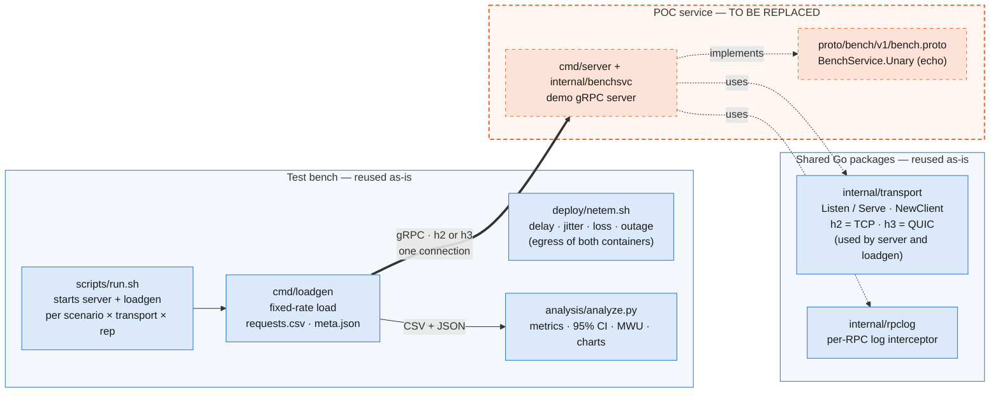
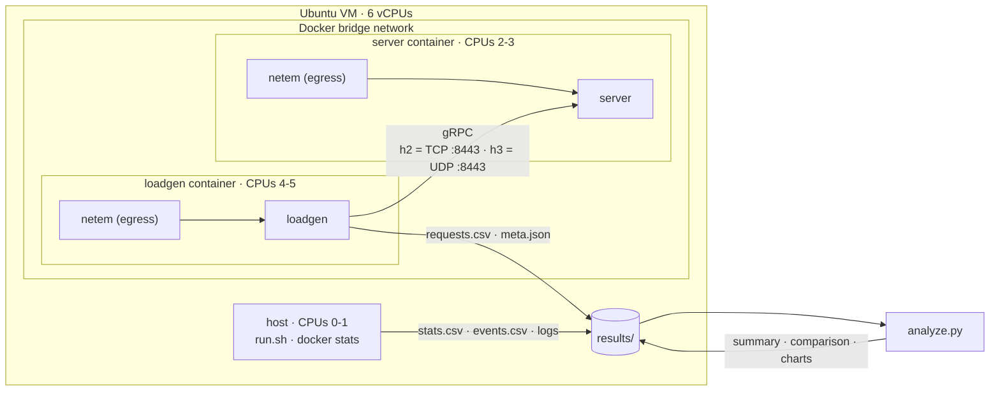
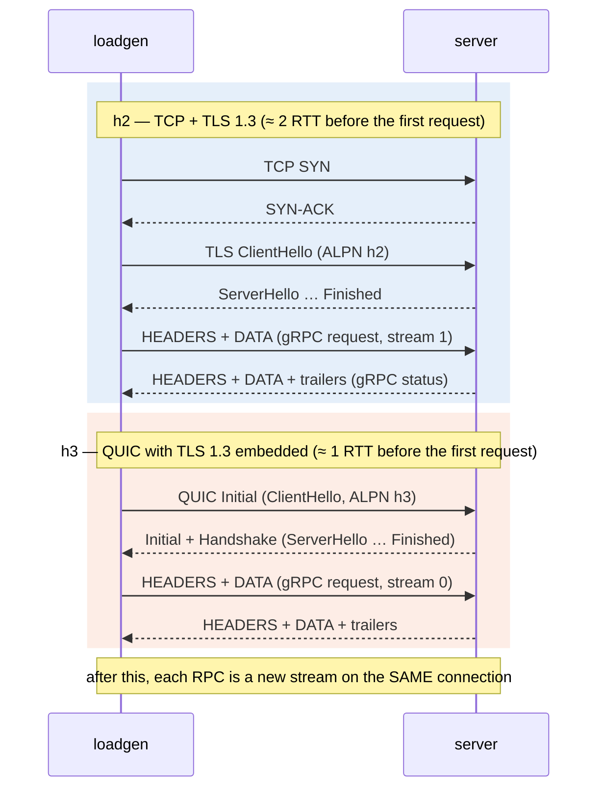
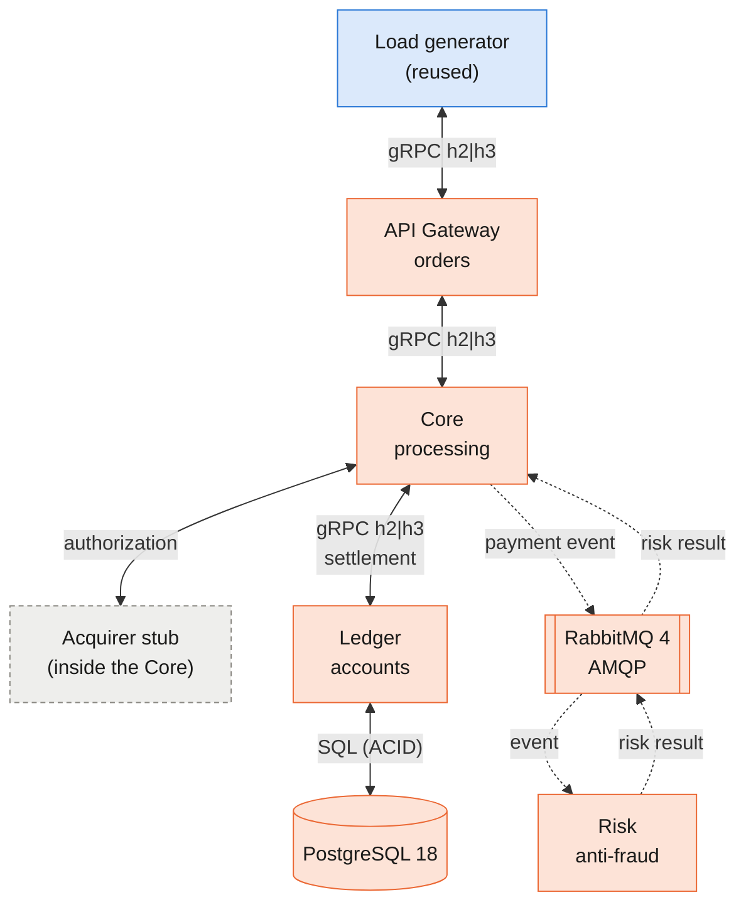

# POC Architecture — gRPC over HTTP/2 (TCP) vs HTTP/3 (QUIC)

## Summary

A minimal gRPC client/server pair whose transport switches between **HTTP/2 over TCP** and **HTTP/3 over QUIC** with one setting (`TRANSPORT=h2|h3`), plus a reproducible test bench:
  - Docker environment;
  - network fault injection (`tc netem`);
  - load generator;
  - automated runner;
  - statistical analysis.

---

## 1. POC architecture

### 1.1 Components

*Blue: reused as-is in the payment processing ecosystem. Orange, dashed: **replaced** by the Gateway, Core, Risk and Ledger services and their contracts (§2).*

**Stack:**
- Go 1.27 with **connect-go v1.21** speaking the real gRPC wire protocol (`connect.WithGRPC()`).
- `net/http` for HTTP/2 and **quic-go v0.63** (`http3`) for HTTP/3.
- Python (pandas, SciPy, matplotlib) for the analysis.

### 1.2 Deployment

Each container gets dedicated CPUs, so the client and server do not compete with each other.

### 1.3 gRPC communication flow

The only variable is the stack **below** gRPC. Everything else is identical in both runs:
- the same binary and the same TLS 1.3 certificate;
- the same limits: 1000 streams per connection, 5 s handshake timeout, 30 s idle timeout, no compression.

| | h2 | h3 |
|---|---|---|
| Application | gRPC (Protobuf) | gRPC (Protobuf) |
| HTTP | HTTP/2 | HTTP/3 |
| Security | TLS 1.3 | TLS 1.3 inside QUIC |
| Transport | TCP | QUIC over UDP |

**Connection setup and RPCs.** The client opens **exactly one connection**. Every RPC is a new stream multiplexed over it. This is required for head-of-line blocking (HoLB) to appear, and it is enforced: each run records a `dials` counter, and any run with `dials ≠ 1` is discarded.

**What happens when a packet is lost:**
- **h2:** all streams share one ordered TCP byte stream. A lost segment holds back the data of **every** stream until it is retransmitted. This is transport-level HoLB.
- **h3:** QUIC delivers each stream independently. A lost packet delays only the stream it belongs to.

**Protocol check.** The server returns an `x-served-proto` header with the protocol actually used. The client aborts if it does not match the requested transport, so there is never a silent fallback to HTTP/2.

### 1.4 Load model

- **Fixed-rate (open-loop) schedule:** the load generator plans the send times as `t_k = t0 + k / rate` and measures each latency from the **planned** time.
- **Why:** this avoids *coordinated omission*. If the server stalls, the RPCs that should have been sent still count with the latency a user would have felt.
- **POC load:** 2000 RPC/s, 500 workers, 60 s measured window after a 10 s warm-up, 1 KiB request and 1 KiB response; 200 RPC/s in the low-load loss scenarios (`-low`).
- **Payment system load:** 300 RPC/s (s1, s3, s5) and 200 RPC/s (`-low`), with the same workers, window, warm-up and 2 s deadline, and natural-size messages (~40 B request, ~44 B response). Four services, PostgreSQL and RabbitMQ share the 6 vCPUs, so the rates come from a calibration sweep ([`PAYMENT-RUN-ANALYSIS.md`](PAYMENT-RUN-ANALYSIS.md#calibração)).

---

## 2. Payment processing ecosystem

The payment gateway described in the project is built **inside this repository**. The four services replace `cmd/server` + `internal/benchsvc`. The transport, load generator, fault injection, runner and analysis are reused **without contract changes**.

*Based on the architecture proposed in the project (Figure 5). Solid double arrows: synchronous request/response. Dotted arrows: asynchronous events through the broker. Blue: reused from the POC. Orange: new. Gray, dashed: external dependency, simulated. The Core calls the Ledger after the authorization; the Risk result is consumed and counted by the Core, off the critical path.*

| Interaction | Type | What goes and what comes back | Protocol |
|---|---|---|---|
| Load generator ⇄ Gateway | Synchronous | Authorization request ⇄ payment response | gRPC h2\|h3 |
| Gateway ⇄ Core | Synchronous | Authorization request ⇄ processing result | gRPC h2\|h3 |
| Core ⇄ Ledger | Synchronous | Settlement request ⇄ final payment state | gRPC h2\|h3 |
| Core ⇄ External acquirers | Synchronous | Authorization request (card, amount) ⇄ approved/declined + authorization code | Simulated; see note |
| Ledger ⇄ Database | Synchronous | SQL statements in an ACID transaction ⇄ rows, commit or error (e.g. lock timeout) | Database driver |
| Core → broker → Risk | Asynchronous | Payment event, one way | AMQP |
| Risk → broker → Core | Asynchronous | Risk result, returned as a new event | AMQP |

**Why the database and acquirer arrows are bidirectional.** Both are synchronous request/response exchanges:
- **Database:** the Ledger sends the statements of a transaction and waits for the result before answering the Core. A failed commit or a lock timeout also comes back on this path.
- **Acquirers:** an authorization is a request/response. The Core sends the card data and amount and waits for the approval or decline, with an authorization code, before it can answer the Gateway. Settlement with the acquirer happens later, in batch, and is outside the scope of this project.

**Decision — acquirer:** a stub inside the Core (approves everything, returns an authorization code, fixed configurable delay, default 0). A separate hop would add nothing measurable to the phase question; "payment not processed due to timeout" shows up as `deadline_exceeded` on the gRPC hops.

| POC today | Payment processing ecosystem |
|---|---|
| `bench.proto` | One `payment.v1` package with the 3 gRPC services and the 2 event messages |
| `cmd/server` + `benchsvc` | `cmd/gateway`, `cmd/core`, `cmd/risk`, `cmd/ledger`, each following the same template: config, `transport.Listen/Serve`, `rpclog`, health check, graceful shutdown |
| `internal/transport` | Unchanged. A single `TRANSPORT` switches **every** synchronous gRPC hop between h2 and h3 |
| `loadgen` | Same binary, targeting the Gateway entry RPC (e.g. `CreatePayment`) |
| `netem.sh` | Only on the gRPC network, on every hop, once per direction |
| `compose.yaml` | Adds the 4 services, RabbitMQ and PostgreSQL on two networks (`rpcnet` for gRPC, with netem; `datanet` for AMQP/SQL, clean). One CPU per critical hop; PostgreSQL, RabbitMQ and Risk share one |
| Scenarios, runner, analysis | Same. **Scenario 4 (IP migration)** gets its own phase, after this one |

**What changes in the results:**
- **Latency** becomes end to end, across several gRPC hops.
- **Asynchronous path:** Core → broker → Risk → broker → Core uses AMQP, so it is outside the h2/h3 comparison. The same applies to the Ledger's database connection.

---

## 3. Test environment and scenarios

### 3.1 Environment

- **Machine:** Ubuntu VM with 6 vCPUs, 8gb ram and Docker Compose, running on a Windows host.
- **CPU pinning:** host tooling on CPUs 0–1, server on CPUs 2–3, load generator on CPUs 4–5. Payment system: host 0, loadgen 1, gateway 2, core 3, ledger 4; PostgreSQL, RabbitMQ and Risk share 5.
- **UDP buffers:** raised on the host to ≥ 7.5 MB, as quic-go recommends.
- **Fault injection:** `tc netem` on the egress of **both** containers, so each value applies **per direction**. For example, 5 ms per side gives a 10 ms RTT.
- **Repetitions:** 50 per scenario and transport (POC) and 60 (payment system), over two runs. The h2/h3 order alternates on each repetition.
- **Validity checks per repetition:**
  - `dials = 1`;
  - not interrupted;
  - no loss of recorded rows;
  - `degraded_s`: seconds below 90% of the target rate with no injected fault, used to flag host noise.

### 3.2 Scenarios

| Scenario (project §3.2) | Config (per side, per hop) | Question |
|---|---|---|
| **s1 — Baseline** | no delay, no loss (RTT < 1 ms) | Raw overhead of QUIC/TLS vs TCP/TLS |
| **s2 — Packet loss** | 1%, 3%, 5% loss per direction, 5 ms delay per side; at the high rate (POC only) and at 200 RPC/s (`-low`) | Impact of TCP HoLB vs QUIC stream independence |
| **s3 — Jitter** | 20 ms ± 10 ms (normal) per side, no loss; netem `rate 10gbit` keeps FIFO order | Stability under delay variation |
| **s5 — Outage (recovery time)** | 5 ms per side + 5 s outage (100% loss): on the server in the POC, on the gateway in the payment system | Time to recover **on the same connection** |
| s4 — Connection migration | *own phase, after the payment system* | Does QUIC's Connection ID keep the session through an IP change? |

In the payment system, netem runs on every gRPC hop, so one RPC crosses 3 hops: the end-to-end base RTT is 30 ms in s2 and s5 and 120 ms in s3. The high-rate s2 left the payment matrix: at 300 RPC/s it would only saturate at 5% loss, and higher rates are CPU-bound. Throughput under loss stays answered by the POC.

### 3.3 Metrics

| Metric | Definition |
|---|---|
| Latency | p50 / p99 / p99.9 of successful RPCs, measured from the planned send time |
| Throughput | Successful RPCs per second. Shown as a **share of the offered load** (the target rate) |
| Error rate | Failed RPCs ÷ total (deadline 2 s) |
| Recovery time (s5) | Seconds from the end of the outage until throughput stays ≥ 90% of the pre-outage level for 3 consecutive seconds |
| Handshake | Duration of the first RPC, which opens the connection |
| CPU cost | Server CPU % per 1000 RPC/s |

**Statistics:** medians with the Hodges–Lehmann shift and its exact CI, Cliff's delta and a two-sided **Mann-Whitney U** test over per-repetition values, corrected by Holm within each scenario.

---

## 4. Results

### 4.1 POC (one hop; two runs, 50 repetitions per transport, 2026-10-07; s1 from 80 clean repetitions, with the 2026-10-01 run)

Details in [`RUN-ALL-ANALYSIS.md`](RUN-ALL-ANALYSIS.md). Medians across repetitions; Δ is the Hodges–Lehmann shift h3 − h2.

| Scenario | Result |
|---|---|
| s1 — Baseline | **Tie in practice.** p50 0.815 / 0.793 ms; h3 p99 16% lower (−0.35 ms); h2 handshake 0.5 ms faster; h3 uses 11% more server CPU per RPC |
| s2-low — Loss, 200 RPC/s | **h3 wins at every level, more as loss grows.** p50 h2 11.9 / 17.1 / 26.8 ms vs h3 11.4 ms at 1 / 3 / 5%; p99 32 / 98 / 302 vs 27 / 27 / 33 ms |
| s2 — Loss, 2000 RPC/s | **h3 serves 1.29× / 2.55× / 3.61× more** (h2 saturates: 78% / 33% / 17% of the demand) |
| s3 — Jitter | Same median (h3 7 ms lower), **h3 p99 4.4× higher** (421 vs 96 ms): quic-go v0.63 declares spurious losses under reordering, cuts the congestion window and does not restore it |
| s5 — Outage | **h2 recovers in 1 s** in 50/50 repetitions; **h3 in 4–5 s** in 45/50 (PTO backoff) |
| Handshake | h3 ~1 RTT faster whenever there is network delay (−9.6 ms at 10 ms RTT) |

### 4.2 Payment system (three hops; two runs, 60 repetitions per transport, 2026-10-16)

Details in [`PAYMENT-RUN-ANALYSIS.md`](PAYMENT-RUN-ANALYSIS.md).

| Scenario | Result | vs the POC |
|---|---|---|
| s1 — Baseline | h3 +0.69 ms at p50 (2.70 vs 3.37 ms) and +1.37 ms at p99; +40% CPU per RPC across the 3 services | the tie turns into a small h3 penalty (likely the CPU cost of QUIC on 6 endpoints at low load) |
| s2-low — Loss | p50 h2 39.8 / 62.2 / 80.3 ms vs h3 33.5 / 33.6 / 33.8 ms; p99 84 / 261 / 446 vs 49 / 62 / 68 ms | **amplified** in absolute terms: at 5% loss the h2 p50 penalty is 3.0× the POC's, consistent with HoLB adding up per hop |
| s3 — Jitter | h3 faster everywhere: p50 −43 ms, p99 216 vs 254 ms; no degraded second in any repetition | **diluted:** the h3 tail is gone, likely because the load per connection is much lower (6.7× fewer RPC/s, ~25× smaller messages) |
| s5 — Outage | both recover in 2 s (median); h3 in 0 s in 17/60 repetitions | **diluted:** h2 is no longer faster |
| Handshake | h3 3 hop RTTs faster (−30 ms at 10 ms per hop) | kept, adding up per hop |

Only s2-low runs at the same rate in both phases, so it is the cleanest transport comparison (messages are still 40–44 B vs 1 KiB). In s1, s3 and s5 the load (300 vs 2000 RPC/s) changed along with the number of hops.
