# Arquitetura do POC — gRPC sobre HTTP/2 (TCP) vs HTTP/3 (QUIC)

Este documento explica como o POC está montado e como ler os números que ele produz. A especificação (o "porquê" de cada decisão) está em [`plan/poc-plan.md`](plan/poc-plan.md); aqui fica o "como funciona".

> **Nota — este POC é o esqueleto do sistema do TCC.** O gateway de pagamentos descrito no TCC (§3.3: Gateway, Core, Risk e Ledger, com mensageria e banco de dados) foi embutido **dentro deste projeto** e substituiu o `cmd/server` + `internal/benchsvc`; o POC continua reproduzível pela tag `poc-v1`. O `transport`, o `rpclog`, o loadgen, o netem, o runner e a análise foram reaproveitados sem mudança de contrato. O que mudou está na [§8](#8-o-sistema-de-pagamentos); a spec é [`plan/payment-plan.md`](plan/payment-plan.md), e os resultados estão em [`PAYMENT-RUN-ANALYSIS.md`](PAYMENT-RUN-ANALYSIS.md).

**Conteúdo**

1. [Visão geral](#1-visão-geral)
2. [Estrutura do projeto](#2-estrutura-do-projeto)
3. [Uso do Go](#3-uso-do-go)
4. [Flow do cliente (loadgen)](#4-flow-do-cliente-loadgen)
5. [Flow do experimento](#5-flow-do-experimento)
6. [Métricas](#6-métricas)
7. [Comandos](#7-comandos)
8. [O sistema de pagamentos](#8-o-sistema-de-pagamentos)

---

## 1. Visão geral

O POC mede a mesma RPC gRPC (`BenchService.Unary`) sobre dois transportes:

| | h2 | h3 |
|---|---|---|
| HTTP | HTTP/2 | HTTP/3 |
| Segurança | TLS 1.3 | TLS 1.3 (dentro do QUIC) |
| Transporte | TCP | QUIC sobre UDP |
| Biblioteca Go | `net/http` nativo | `quic-go/http3` |

Tudo o mais é idêntico: o mesmo binário, o mesmo certificado, os mesmos timeouts e limites (§3.3), e uma única conexão por execução.

Um único parâmetro, `TRANSPORT=h2|h3`, troca a pilha inteira. O servidor e o gerador de carga (loadgen) rodam em contêineres separados, com CPUs dedicadas, e falhas de rede (atraso, jitter, perda, apagão) são injetadas com `tc netem`.

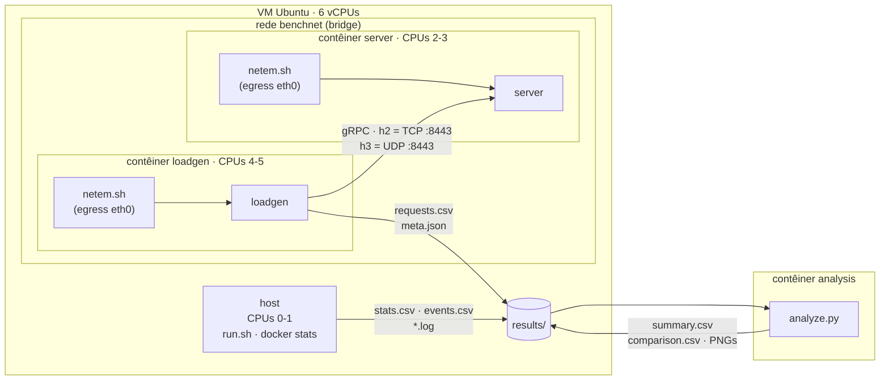

**Etapas do experimento:**
1. O `run.sh` sobe o servidor e espera o health check passar.
2. Roda o loadgen com a carga do cenário.
3. Coleta os arquivos e derruba os contêineres.
4. Repete para cada cenário × transporte × repetição.
5. No fim, o `analyze.py` agrega tudo.

---

## 2. Estrutura do projeto

```text
.
├── proto/bench/v1/bench.proto     contrato da RPC (fonte)
├── gen/bench/v1/…                 código gerado pelo buf (commitado)
├── cmd/
│   ├── server/                    binário do servidor + subcomando healthcheck
│   └── loadgen/                   binário do gerador de carga
├── internal/
│   ├── transport/                 h2/h3 atrás de uma API única (reusável)
│   │   └── transporttest/         certificados de teste
│   ├── benchsvc/                  implementação do BenchService
│   ├── rpclog/                    interceptor de log por RPC (reusável)
│   └── loadgen/                   runner (carga), recorder (CSV), meta.json
├── deploy/
│   ├── Dockerfile                 imagens server, loadgen e analysis
│   ├── compose.yaml               serviços, CPUs, rede, variáveis
│   └── netem.sh                   injeção de falhas (entrypoint dos contêineres)
├── experiments/scenarios/*.env    um arquivo por cenário (netem + carga)
├── scripts/
│   ├── gen-certs.sh               CA + certificado do servidor
│   ├── host-tuning.sh             buffers UDP e módulo sch_netem na VM
│   └── run.sh                     runner da matriz de experimentos
├── analysis/
│   ├── analyze.py                 métricas, estatística e gráficos
│   └── tests/                     pytest com dados sintéticos
├── tools/go.mod                   ferramentas (buf, protoc-gen-*) isoladas
├── Makefile                       ponto de entrada de tudo
└── doc/                           spec, planos e este documento
```

### 2.1 Dependências entre pacotes Go

As setas indicam "importa". O `transport` não conhece gRPC nem o benchmark, por isso pode ser reaproveitado pelos microsserviços do TCC.

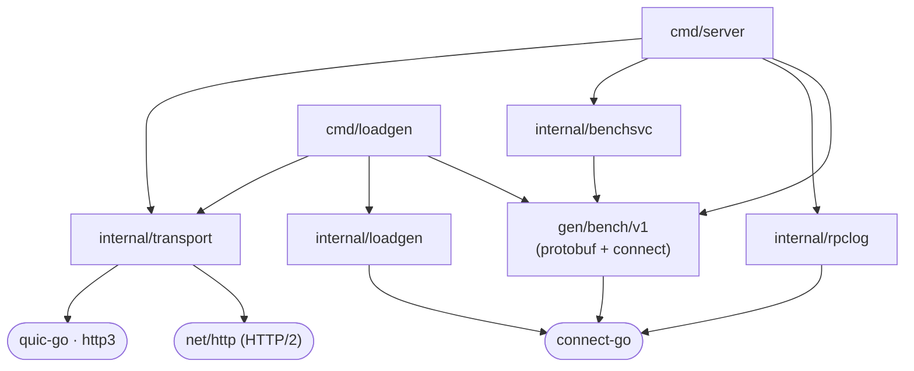

### 2.2 O contrato

```proto
service BenchService {
  rpc Unary(UnaryRequest) returns (UnaryResponse);
}
message UnaryRequest  { bytes payload = 1; uint32 response_size = 2; uint32 server_delay_us = 3; }
message UnaryResponse { bytes payload = 1; }
```

O cliente escolhe o tamanho do pedido (`payload`) e o da resposta (`response_size`, até 1 MiB). O `server_delay_us` opcional simula processamento; nos cenários ele fica em 0.

---

## 3. Uso do Go

**Versões** (fixadas na §11 do spec):
- Go 1.27.1;
- connect-go v1.21.0;
- quic-go v0.63.0;
- protobuf v1.36.12;
- buf v1.73.0.

### 3.1 Duas pilhas atrás de uma API

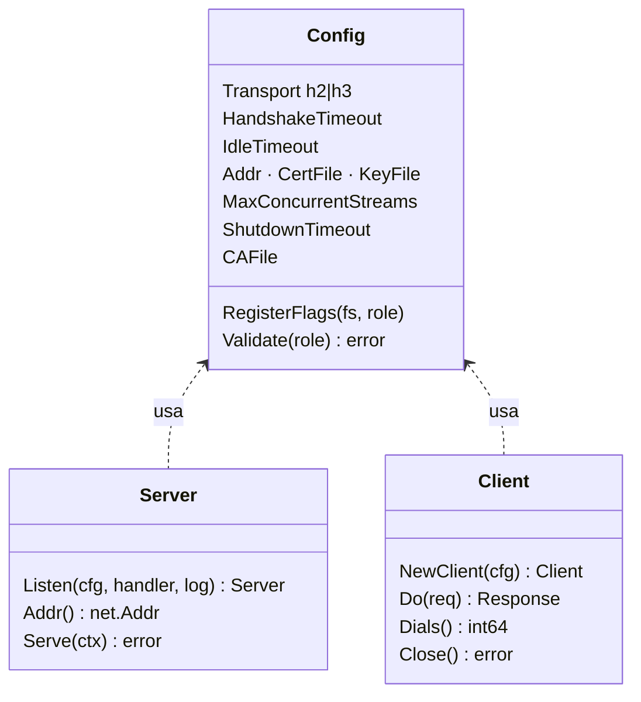

- **`Listen`** valida a config, carrega o TLS e abre o socket. Em h2, o socket é TCP e é servido por `http.Server`; em h3, é UDP e é servido por `http3.Server`.
- **`Serve`** bloqueia até o contexto ser cancelado (SIGTERM) e faz um shutdown graceful dentro do `ShutdownTimeout`.
- **`NewClient`** devolve um `*Client` que satisfaz o `connect.HTTPClient`, então o código gerado pelo connect o usa sem saber qual é o transporte.
- **Header `x-served-proto`:** todo response leva esse header, com o protocolo realmente usado (`HTTP/2.0` ou `HTTP/3.0`). O `VerifyServedProto` confere o valor, e um run nunca passa por um fallback silencioso.

**Erros tipados:** `ErrInvalidTransport`, `ErrInvalidConfig`, `ErrTLSConfig` e `ErrProtoMismatch`. Toda configuração é validada na inicialização. `Validate` junta todos os problemas numa única mensagem, citando a flag e a variável de ambiente de cada um.

### 3.2 HTTP/2 nativo e HTTP/3

| Aspecto | h2 (`net/http`) | h3 (`quic-go/http3`) |
|---|---|---|
| Servidor | `http.Server{Protocols: HTTP2 only, HTTP2: {MaxConcurrentStreams}}` + `ServeTLS` | `http3.Server{QUICConfig: {MaxIncomingStreams, MaxIdleTimeout, HandshakeIdleTimeout}}` + `Serve(udpConn)` |
| Cliente | `http.Transport{Protocols: HTTP2 only, HTTP2: {StrictMaxConcurrentRequests: true}, MaxConnsPerHost: 1}` | `http3.Transport{QUICConfig: {…}}` |
| Dial | `DialTLSContext` próprio: aplica o timeout de handshake, conta a conexão e rejeita ALPN ≠ `h2` | `Dial` próprio: `quic.DialAddrEarly` e conta a conexão |
| ALPN | `h2` | `h3` (obrigatório no QUIC) |

- **Por que HTTP/2 nativo:** desde o Go 1.24 o `net/http` expõe `Protocols` e `HTTP2Config`, e no Go 1.27 o `golang.org/x/net/http2` virou só um invólucro. O projeto não importa `x/net/http2`.
- **Por que uma única conexão:** a comparação é entre um transporte e outro, não entre pools de conexões.
  - No h2, `StrictMaxConcurrentRequests` impede que o cliente abra uma segunda conexão quando o limite de streams enche.
  - No h2, `MaxConnsPerHost: 1` serializa os dials, então uma rajada inicial compartilha a mesma conexão.
  - O `http3.Transport` já usa uma conexão por host.
  - O contador `Dials()` vai para o `meta.json` e precisa terminar em 1; uma repetição com outro valor é descartada pela análise.
- **Limite conhecido do Go:** com `StrictMaxConcurrentRequests`, se houver mais RPCs em voo do que o `MAX_CONCURRENT_STREAMS` do servidor, o cliente h2 do Go trava. Por isso o `--concurrency` fica sempre ≤ 1000.

### 3.3 Parâmetros simétricos

| Parâmetro | Valor | h2 | h3 |
|---|---|---|---|
| Streams por conexão | 1000 | `HTTP2Config.MaxConcurrentStreams` | `QUICConfig.MaxIncomingStreams` |
| Timeout de handshake | 5 s | timeout no `DialTLSContext` + `ReadHeaderTimeout` | `HandshakeIdleTimeout` |
| Idle | 30 s | `IdleTimeout` / `IdleConnTimeout` | `MaxIdleTimeout` |
| Keepalive de aplicação | desligado | — | — |
| TLS | 1.3 mínimo, mesmo certificado | `tls.Config` | `tls.Config` |
| Compressão | desligada | gzip não registrado | idem |

### 3.4 connect-go, gRPC e o interceptor de log

- **Protocolo:** o cliente usa `connect.WithGRPC()`, então o que trafega é gRPC de verdade (framing gRPC, trailers). O connect foi escolhido porque funciona sobre qualquer `http.Handler`/`http.Client`. O `grpc-go` exigiria o próprio transporte HTTP/2 e não suporta HTTP/3.
- **`internal/rpclog`:** um `connect.Interceptor` que grava uma linha JSON por RPC unária, com `procedure`, `code`, `duration_us`, `peer` e `protocol`.
  - Sai no nível `debug`, e o padrão do servidor é `info`, então fica desligado nas medições. Desligado, custa só uma checagem de nível.
  - Liga com `LOG_LEVEL=debug`.
  - É a base do log dos microsserviços da próxima fase.

### 3.5 Configuração e ciclo de vida do servidor

A configuração segue a ordem **flag > variável de ambiente > padrão**. Os nomes vêm em pares, por exemplo `--transport`/`TRANSPORT` e `--log-level`/`LOG_LEVEL`. Valor inválido faz o processo sair com código ≠ 0 antes de abrir qualquer socket.

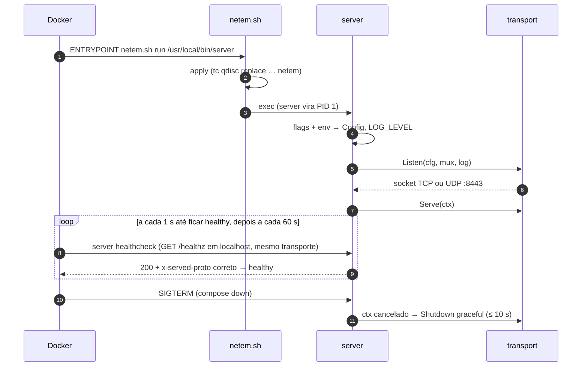

O health check vai por `lo`, onde o netem não atua, e prova que o socket real (TCP ou UDP) está aceitando conexões.

---

## 4. Flow do cliente (loadgen)

### 4.1 Do início ao fim de uma execução

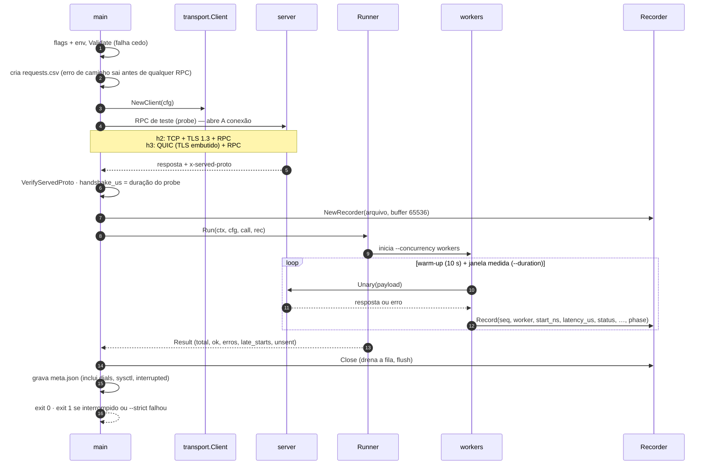

Detalhes importantes:
- **Probe antes da carga:** o probe roda antes de soltar os workers. Assim a conexão já existe quando a carga começa, e `dials` fica em 1.
- **SIGTERM ou Ctrl-C:** o loadgen para rápido e ainda grava o CSV e o `meta.json` com `interrupted: true`, depois sai com código 1. A análise descarta essa repetição.
- **Warm-up:** as linhas do warm-up ficam no CSV com `phase=warmup` e a análise as ignora.

### 4.2 Uma RPC em h2 e em h3

A diferença que o experimento explora é o que acontece abaixo do HTTP:

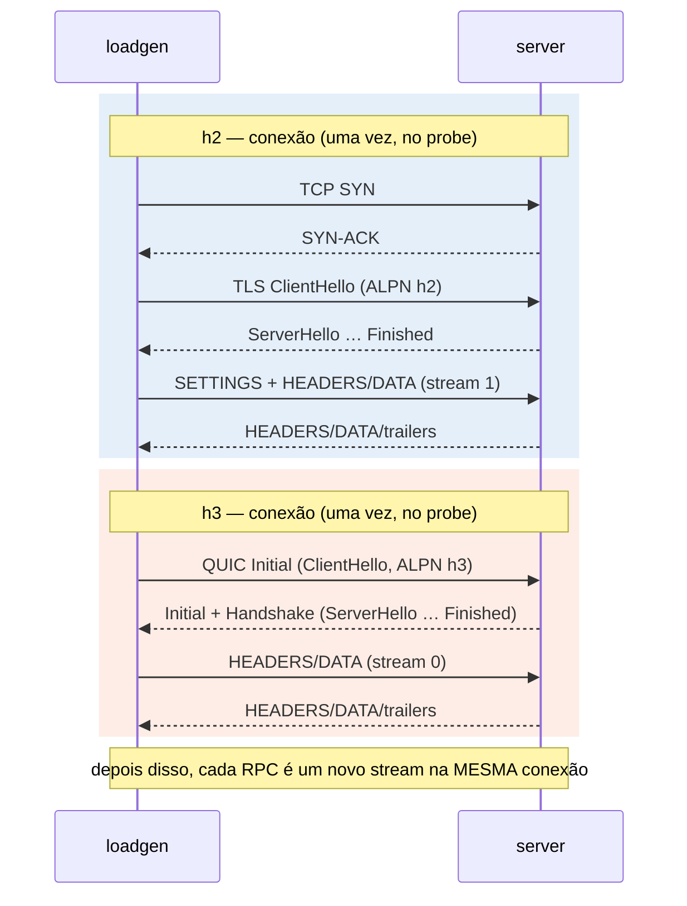

- **Perda de pacote no h2:** todos os streams dividem um único fluxo TCP. Um pacote perdido segura a entrega dos bytes seguintes de todos os streams até a retransmissão chegar. É o *head-of-line blocking* (HoLB).
- **Perda de pacote no h3:** cada stream QUIC é entregue de forma independente. Um pacote perdido só atrasa o stream a que ele pertence.

### 4.3 Os dois modos de carga

| | Loop fechado (`--rps=0`) | Taxa fixa (`--rps=N`, usado nos cenários) |
|---|---|---|
| Quem dita o ritmo | a velocidade do servidor | uma agenda global `t_k = t0 + k/N` |
| Workers | cada worker manda a próxima RPC assim que recebe a anterior | recebem os horários `t_k` por um canal |
| `start_ns` | instante do envio | `t_k` (horário planejado) |
| `latency_us` | do envio à resposta | de `t_k` à resposta, incluindo a espera por worker livre |
| Serve para | capacidade máxima | latência de transporte sem distorção |

No modo taxa fixa:

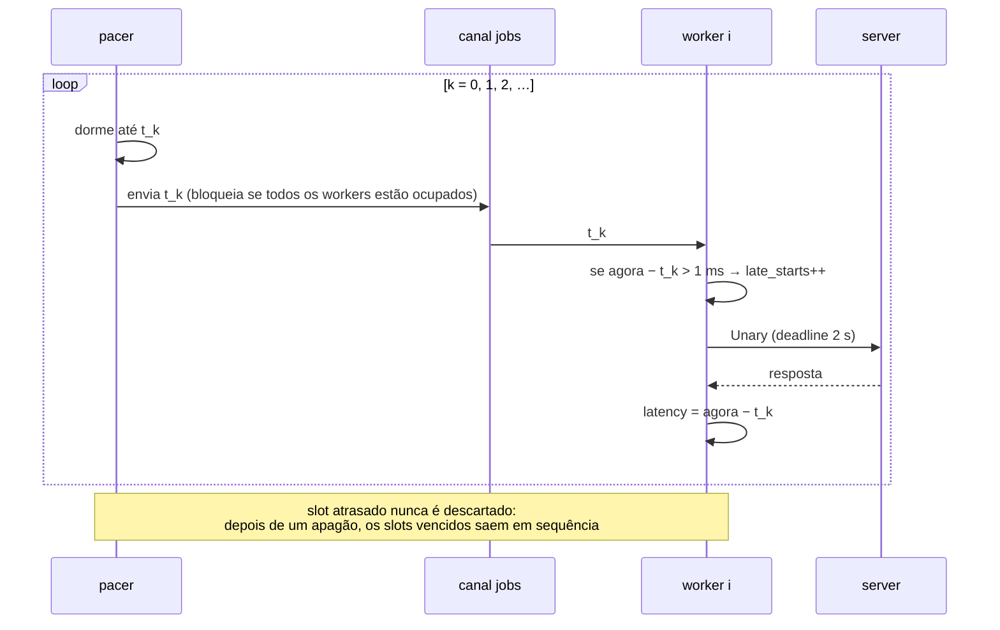

Medir desde `t_k` corrige a *coordinated omission*. Num loop fechado, um servidor travado também trava o cliente, que deixa de enviar pedidos; a lentidão some das estatísticas. Com a agenda fixa, cada RPC que deveria ter saído e esperou entra com a latência real que um usuário teria sentido.

Dimensionamento usado nos cenários: `--rps=2000 --concurrency=500`.
- **Taxa:** 2000 RPC/s fica em ~40% da capacidade medida do h2, então a CPU não vira gargalo.
- **Workers:** para não criar fila artificial, é preciso ter pelo menos taxa × latência de workers livres: 2000 × 250 ms = 500.
- **Teto:** 500 fica abaixo de 1000, o limite de streams do h2 (§3.2).

### 4.4 O Recorder

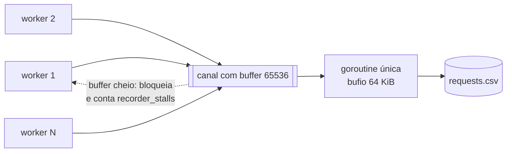

- **Um único escritor:** só uma goroutine escreve no arquivo, então os workers nunca disputam o acesso a ele.
- **Nenhuma linha se perde:** com o buffer cheio, o worker espera, e isso é contado em `recorder_stalls`. Esse contador deve ficar em 0.
- **Erro de escrita:** o escritor continua drenando a fila, para os workers nunca travarem, e o erro é devolvido no `Close`.

---

## 5. Flow do experimento

### 5.1 Uma repetição (`run.sh rep`)

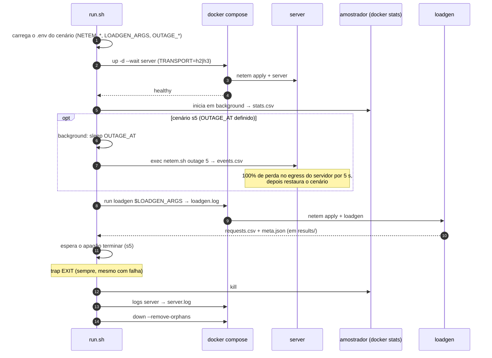

**A matriz (`run.sh` sem argumentos):**
- Percorre `cenário × repetição × transporte` e alterna a ordem h2/h3 a cada repetição, para diluir efeitos térmicos e de cache.
- Cada repetição roda num processo próprio. Se falhar, vai para o `failures.log` e a matriz continua.
- Se a falha for no probe (`loadgen failed … probe:` no `loadgen.log`), a repetição roda mais uma vez: com perda, os pacotes do handshake retransmitidos podem passar do prazo de 7 s do probe. A tentativa que falhou fica em `probe-failed-rep-N`, que a análise ignora; só a segunda falha vai para o `failures.log`.
- O nome da pasta é o horário local, `AAAA-MM-DD-HH-MM-SS`. Se a pasta já existir, o runner para: resultado é imutável.

### 5.2 Injeção de falhas (`netem.sh`)

O netem atua no egress do `eth0` dos **dois** contêineres, então os valores valem **por direção**. Um atraso de 5 ms por lado dá um RTT de 10 ms.

| Cenário | Atraso/lado | Jitter | Perda | Objetivo |
|---|---|---|---|---|
| `s1-baseline` | 0 | 0 | 0% | custo do QUIC/TLS sem falhas |
| `s2-loss-{1,3,5}` | 5 ms | 0 | 1/3/5% | capacidade sob perda (2000 RPC/s satura o h2) |
| `s2-loss-{1,3,5}-low` | 5 ms | 0 | 1/3/5% | latência e HoLB do TCP a 200 RPC/s, abaixo da capacidade do h2 |
| `s3-jitter` | 20 ms | 10 ms (normal) | 0% | variação de atraso, sem reordenação |
| `s5-outage` | 5 ms | 0 | 0% + apagão de 5 s | tempo de recuperação na mesma conexão |

Com jitter, o `netem.sh` acrescenta `rate 10gbit`. Sem isso, cada pacote recebe um atraso sorteado e independente, e pacotes enviados com ~0,5 ms de intervalo chegam fora de ordem: as duas pilhas tratam isso como perda e o s3 colapsa. Com `rate`, o netem agenda cada pacote no máximo entre o seu sorteio e a saída do anterior, como numa fila FIFO real. O custo: com muitos pacotes por segundo, o jitter vira um atraso médio maior com saídas em rajadas. Uma `pfifo` filha não resolve, porque o netem só entrega os pacotes a ela depois do atraso de cada um.

O apagão do s5 é aplicado só no servidor, e o `events.csv` registra os instantes reais (Unix ns) de início e fim. O `OUTAGE_AT` conta a partir da subida do servidor, então o apagão cai por volta de 20 s depois do início da janela medida.

### 5.3 Árvore de resultados

```text
results/2026-09-28-11-11-52/
├── failures.log                      só existe se alguma repetição falhou
├── s5-outage/
│   ├── h2/rep-1/
│   │   ├── requests.csv              uma linha por RPC
│   │   ├── meta.json                 config, contadores, dials, sysctl
│   │   ├── stats.csv                 CPU/memória dos contêineres (~2 s)
│   │   ├── events.csv                só no s5
│   │   ├── server.log · loadgen.log
│   └── h3/rep-1/ …
└── analysis/                         gerado por make analyze
    ├── reps.csv · summary.csv · comparison.csv
    └── latency_cdf.png · p99_boxplot.png · s5_throughput.png
```

---

## 6. Métricas

### 6.1 De onde vêm os dados

**`requests.csv`** tem uma linha por RPC:

| Coluna | Significado |
|---|---|
| `seq` | número sequencial global da RPC |
| `worker` | worker que executou |
| `start_ns` | Unix ns do horário **planejado** (taxa fixa) ou do envio (loop fechado) |
| `latency_us` | de `start_ns` até a resposta ou o erro |
| `status` | `ok` ou o código gRPC (`deadline_exceeded`, `unavailable`, …) |
| `req_bytes` · `resp_bytes` | payload enviado e recebido |
| `phase` | `warmup` ou `measure`; **só `measure` entra na análise** |

**`meta.json`** guarda a configuração efetiva e os contadores da execução.

| Campo | Para que serve |
|---|---|
| `dials` | precisa ser 1; outro valor invalida a repetição |
| `interrupted` | repetição interrompida é descartada |
| `handshake_us` | duração do probe |
| `late_starts` · `unsent` | sinais de saturação do loadgen no modo taxa fixa; contam só os slots da medição (rodadas anteriores à correção do M7 incluíam o aquecimento) |
| `recorder_stalls` | deve ser 0 |
| `sysctl` | buffers UDP que o QUIC viu |

**Os outros arquivos:**
- **`stats.csv`:** `ts_ns,name,cpu_perc,mem_usage`, com uma amostra do `docker stats` a cada ~2 s. Só as amostras dentro da janela medida entram nas médias.
- **`events.csv`:** `outage_start` e `outage_end`, em Unix ns.

### 6.2 Métricas por repetição (`reps.csv`)

| Métrica | Cálculo | Leitura |
|---|---|---|
| `p50` `p90` `p99` `p999` | percentis (interpolação linear) de `latency_us` das RPCs `ok` | p50 = caso típico; p99/p99.9 = cauda, onde o HoLB aparece |
| `p50_all` `p99_all` `p999_all` | percentis sobre todos os slots da medição: `ok` pela latência, erros por `max(latência, prazo)` e `unsent` pelo prazo (`load.deadline_ns`) | sem viés de sobrevivência; como os `p*`, só valem sem saturação (`served_frac` ≈ 1), porque os `unsent` entram por baixo |
| `lat_mean` · `lat_std` | média e desvio de `latency_us` das `ok` | complementar |
| `ok_rps` | RPCs `ok` ÷ janela `[min start, max(start + latency)]` | com taxa fixa deve ficar ≈ `--rps` |
| `mb_s` | bytes de pedido + resposta das `ok` ÷ janela ÷ 10⁶ | vazão de payload |
| `error_rate` | RPCs `≠ ok` ÷ total | ignora os slots que nem foram enviados |
| `served_frac` | `ok ÷ (rps × duration)`, do `meta.json`; `NaN` em loop fechado | fração da demanda atendida; abaixo de 1 indica saturação |
| `handshake_ms` | `handshake_us / 1000` | custo de abrir a conexão (§6.3) |
| `server_cpu` · `loadgen_cpu` | média de CPU% (100% = 1 vCPU; teto 200% com 2 vCPUs) | |
| `server_mem_mib` · `loadgen_mem_mib` | média de memória | |
| `cpu_per_krps` | `server_cpu ÷ (ok_rps / 1000)` | CPU do servidor por 1000 RPC/s: eficiência de cada pilha |
| `recovery_s` (s5) | ver §6.4 | |
| `degraded_s` | nº de bins de 1 s, fora do apagão, com vazão `ok` < 90% do `--rps` | ver §6.5 |
| `run` · `excluded` | pasta da rodada; repetição descartada por `--exclude-degraded` | não são métricas; a repetição é identificada por (`run`, `rep`) |

### 6.3 `handshake_ms` — o que ele inclui

O probe mede o tempo para abrir a conexão **mais** uma RPC:

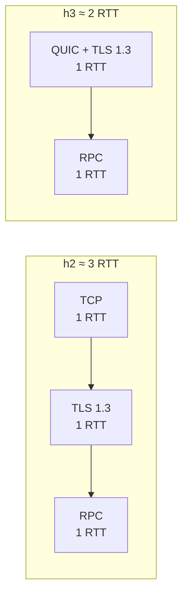

Com um RTT de 10 ms, a teoria prevê cerca de 30 ms para o h2 e 20 ms para o h3, mais o processamento. Na rodada do s5, deu 47,8 ms no h2 e 39,0 ms no h3 (−18%).

### 6.4 Tempo de recuperação (s5)

**Definição:** o tempo desde o fim do apagão até a vazão `ok`, em janelas de 1 s, voltar a pelo menos 90% da média de antes do apagão por **3 janelas seguidas**. As janelas são alinhadas no instante `outage_end`.

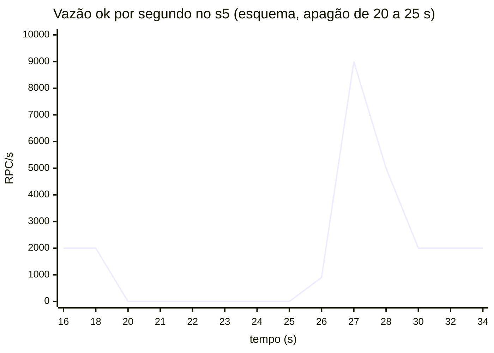

| Trecho | O que acontece |
|---|---|
| até 20 s | vazão estável ≈ `--rps`: é a base (média antes do apagão) |
| 20–25 s | apagão: nenhuma resposta chega; as RPCs presas estouram o deadline de 2 s (`deadline_exceeded`) e os novos slots da agenda se acumulam |
| 25 s → | a rede volta, mas a conexão só volta quando o próximo timer de retransmissão dispara |
| pico | os slots acumulados saem de uma vez: a vazão passa muito da taxa por 1–3 s |
| depois | 3 janelas seguidas ≥ 90% da base → fim da recuperação |

- **Por que a volta atrasa:** durante o apagão, o TCP (h2) e o QUIC (h3) dobram o intervalo dos timers de retransmissão (RTO e PTO) a cada tentativa sem resposta. Por isso o próximo disparo pode cair segundos depois de a rede já ter voltado, e é esse atraso que o `recovery_s` mede.
- **Por que o p99 do s5 fica em segundos:** as RPCs agendadas durante o apagão entram com latência desde o horário planejado. No s5, a métrica relevante é o `recovery_s`, não o p99.

Rodada de 10 repetições: **h2 1,2 s**, e **h3 3,6 s**, com as repetições do h3 divididas entre 1–2 s e 4–5 s. Essa divisão bate com a fase do backoff do PTO em relação ao fim do apagão.

### 6.5 `degraded_s` — detector de ruído

Conta os segundos em que a vazão ficou abaixo de 90% da taxa pedida fora do apagão. Não entram:
- o primeiro bin da janela e os bins depois do último envio, que são parciais;
- o apagão, da queda até a recuperação.

Como ler o valor:
- **s1 e s5:** o valor esperado é 0. Qualquer valor acima de 0 aponta ruído do host, como a contenção de CPU na VM: a mesma carga passa a custar o dobro de CPU e a vazão cai. Essas repetições também têm um p50 mais alto.
- **s2 e s3:** também pode ser efeito do próprio transporte, com retransmissões segurando as respostas por mais de um bin.

O `analyze` avisa no terminal quando uma repetição tem `degraded_s > 0`. Com `--exclude-degraded=s1-baseline,s5-outage` (ou `make analyze … EXCLUDE=…`), essas repetições saem do `summary.csv`, do `comparison.csv` e dos gráficos; o `reps.csv` mantém todas, com `excluded = True`, e o `summary.csv` mostra `n_excluded`. Use só em cenários sem perda ou jitter injetados.

### 6.6 Agregação e estatística

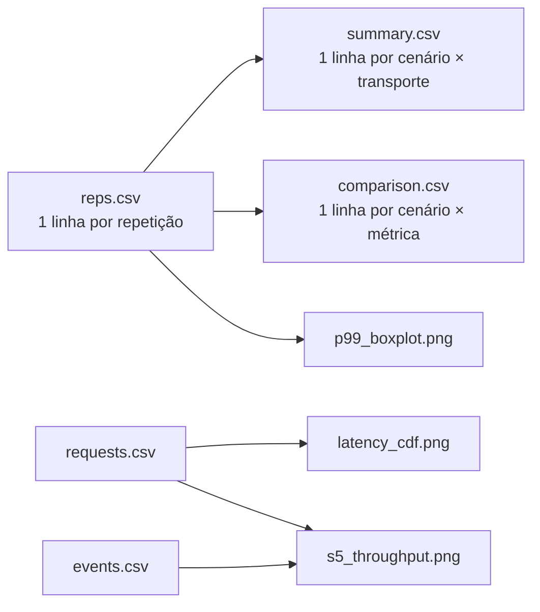

| Saída | Conteúdo |
|---|---|
| `summary.csv` | para cada métrica: `<m>_mean` e `<m>_ci95` (meia-largura do IC 95% com t de Student, `n−1` graus de liberdade); `<m>_median`, `<m>_med_lo`, `<m>_med_hi` e `<m>_med_level` (IC da mediana por estatísticas de ordem, sem supor distribuição); `n`, `n_excluded`; `cv_p50` = desvio ÷ média do p50 entre repetições; `mwu_p` = Mann-Whitney sobre o p99 |
| `comparison.csv` | `h2_mean`, `h3_mean`, `delta_pct = (h3 − h2) / h2 × 100` (negativo = h3 menor); `mwu_p` (Mann-Whitney U bilateral sobre os valores por repetição) e `mwu_p_holm` (corrigido por Holm entre as métricas do cenário); `n_h2`, `n_h3`; `h2_median`, `h3_median`; `hl_shift`, `hl_lo`, `hl_hi`, `hl_level` (deslocamento de Hodges–Lehmann h3 − h2 com IC exato); `cliff_delta` e `cliff_mag`; para `ok_rps` e `served_frac`, `ratio`, `ratio_lo`, `ratio_hi` (razão h3/h2 com IC) |

Como ler:
- **IC 95%:** `p99_mean ± p99_ci95` é o intervalo onde a média verdadeira está com 95% de confiança.
- **`mwu_p` < 0,05:** a diferença entre h2 e h3 é estatisticamente significativa. Com 5 repetições por lado, o menor p possível é ≈ 0,008. O teste não assume distribuição normal, o que convém para latências.
- **`cv_p50` < 0,10:** critério de estabilidade do spec (§6.6). Acima disso, a repetição tem ruído demais; confira o `degraded_s`.
- **Mediana e Hodges–Lehmann:** robustos a repetições com ruído e a distribuições assimétricas; prefira-os à média no texto. O IC é o mais estreito com cobertura ≥ 95%; quando o `n` não permite, é o intervalo inteiro (`[mín, máx]`), e `*_level` mostra a cobertura real (n = 5: 93,75% na mediana; 5 × 5: 96,8% no deslocamento).
- **`cliff_delta`:** de −1 a 1, fração de pares h3 > h2 menos a de pares h3 < h2. Mostra quão separados estão os grupos, o que o p não mostra: com 5 × 5, toda separação total dá p = 0,008. `cliff_mag` segue Romano et al. (2006): < 0,147 desprezível, < 0,33 pequeno, < 0,474 médio, senão grande.
- **`mwu_p_holm`:** cada cenário é uma família de ~10 testes; use este p para afirmar significância.
- **`ratio`:** Hodges–Lehmann sobre o log dos valores, ou seja, a razão típica h3/h2 (ex.: "o h3 atende 2,6× [2,56–2,63] mais"). `NaN` se algum valor for ≤ 0.
- **Repetições descartadas:** repetições sem `meta.json`, interrompidas, com `dials ≠ 1` ou listadas no `failures.log` não entram, e o `analyze` avisa quais foram. O `n` mostra quantas sobraram.

Exemplo real (s5, 10 repetições por transporte):

| métrica | h2 | h3 | delta | p | leitura |
|---|---|---|---|---|---|
| p50 | 12,19 ms | 12,26 ms | +0,5% | 0,91 | sem diferença no caso típico |
| recovery_s | 1,2 s | 3,6 s | +200% | 0,003 | h3 demora mais a voltar depois do apagão |
| handshake_ms | 47,8 | 39,0 | −18% | 0,0002 | QUIC abre a conexão com 1 RTT a menos |
| cpu_per_krps | 47,2 | 44,8 | −5% | 0,38 | eficiência equivalente |

### 6.7 Os gráficos

| Gráfico | O que mostra | Como ler |
|---|---|---|
| `latency_cdf.png` | um painel por cenário: fração das RPCs `ok` (eixo y) com latência ≤ x (eixo x log). Cada curva é a média dos quantis das repetições | curva mais à esquerda = mais rápido; a diferença na parte de cima (y > 0,99) é a cauda |
| `p99_boxplot.png` | p99 de cada repetição por cenário e transporte (caixa + pontos) | a dispersão mostra a estabilidade; caixas separadas sugerem diferença real (confira o `mwu_p`) |
| `s5_throughput.png` | vazão `ok` por segundo, alinhada no início do apagão (faixa cinza), uma linha por repetição | a queda a zero, o tempo até voltar, o pico de backlog e ruídos fora do apagão |

---

## 7. Comandos

| Comando (na VM) | Faz |
|---|---|
| `sudo bash scripts/host-tuning.sh` | uma vez por boot: sobe os buffers UDP (nunca reduz) e carrega o `sch_netem` |
| `make certs` | gera `certs/ca.crt`, `server.crt`, `server.key` |
| `make build` | imagens do server e do loadgen |
| `make test` · `make test-py` | testes Go (`-race`) e pytest em contêiner |
| `make smoke TRANSPORT=h2\|h3` | 1000 RPCs com `--strict` (falha se algo ≠ ok ou `dials` ≠ 1) |
| `SCENARIOS=s5-outage REPS=5 make run-all` | roda a matriz (ou um subconjunto) |
| `make analyze RUN=<pasta>` | gera `analysis/` dentro do run |
| `make analyze RUN="<pasta> <pasta>" OUT=<pasta>` | junta várias rodadas (avisa se a carga ou o commit diferem); `OUT` fica em `results/` |
| `make analyze RUN=<pasta> EXCLUDE=s1-baseline,s5-outage` | descarta as repetições com `degraded_s > 0` nesses cenários (§6.5) |
| `LOG_LEVEL=debug make run-all …` | liga o log por RPC no servidor (afeta as medições; só para depuração) |
| `QLOG=1 SCENARIOS=s3-jitter REPS=1 make run-all` | diagnóstico: qlog dos dois lados QUIC em `<rep>/qlog/*.sqlog` e contadores TCP/UDP do servidor em `<rep>/nstat.txt` (afeta as medições; não usar nas rodadas do TCC) |

No Windows rodam apenas `go build ./...`, `go vet ./...`, `go test ./...` e `pytest analysis`.

---

## 8. O sistema de pagamentos

O POC validou a parte difícil e reutilizável: o transporte h2/h3 simétrico, a carga sem distorção, a injeção de falhas e a análise. O sistema do TCC, o **gateway de pagamentos** (TCC §3.3, Figura 5), foi embutido neste repositório trocando só a camada de serviço. As decisões e o porquê de cada uma estão em [`plan/payment-plan.md`](plan/payment-plan.md) §2.

### 8.1 Os serviços

| Serviço | Papel | Comunicação |
|---|---|---|
| **Gateway** (`cmd/gateway`) | ponto único de entrada da carga; valida o pedido e chama o Core | servidor gRPC do loadgen; cliente gRPC do Core |
| **Core** (`cmd/core`) | regras de negócio; **adquirente simulado** por um stub interno (aprova tudo, atraso `ACQUIRER_DELAY`, padrão 0); chama o Ledger; publica o evento de pagamento | servidor gRPC do Gateway; cliente gRPC do Ledger; AMQP |
| **Ledger** (`cmd/ledger`) | liquidação: `INSERT` idempotente pelo `payment_id` + `UPDATE` condicional do saldo numa transação | servidor gRPC do Core; SQL (`pgx/v5`) |
| **Risk** (`cmd/risk`) | pontuação de risco (`FNV-1a(payment_id) mod 100`), fora do caminho crítico | só AMQP: consome `payment.events`, publica `risk.results` |
| **RabbitMQ 4** | broker, filas `payment.events` e `risk.results`, mensagens transitórias | AMQP 0-9-1 |
| **PostgreSQL 18** | contas e lançamentos; `synchronous_commit=off`, sem volume | SQL |

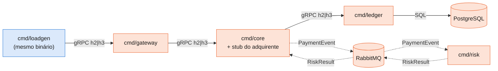

Azul: reaproveitado do POC. Laranja: novo. Setas cheias: caminho síncrono, medido. Pontilhadas: caminho assíncrono, fora do caminho crítico; o Core só conta os resultados (`risk_results`).

### 8.2 Onde cada peça entrou

| No POC | No sistema de pagamentos |
|---|---|
| `proto/bench/v1/bench.proto` | **um único pacote** `proto/payment/v1/payment.proto`, com os 3 serviços gRPC (`PaymentService`, `CoreService`, `LedgerService`) e as 2 mensagens de evento (`PaymentEvent`, `RiskResult`), gerado pelo mesmo `buf generate` em `gen/payment/v1`. Os tipos são compartilhados, então um pacote por serviço só duplicaria código |
| `cmd/server` + `internal/benchsvc` | **removidos**; no lugar, `cmd/{gateway,core,ledger,risk}` com a lógica em `internal/{gateway,core,ledger,risk}`, o AMQP em `internal/broker`, a validação comum em `internal/payment` e o molde comum em `internal/service` (config, `/healthz`, `healthcheck`, shutdown graceful, `svc-<nome>.json`) |
| `internal/transport` | **sem mudança**. Cada serviço usa `Listen` como servidor e um `NewClient` por salto de saída. Um único `TRANSPORT` troca os três saltos gRPC, cada um com uma conexão (`dials = 1`); um interceptor confere o `x-served-proto` em toda resposta |
| `internal/rpclog` | registrado em servidores e clientes (campo `side`), com o `payment_id` em toda linha e, nas linhas de cliente, a versão HTTP servida (`http`) |
| `cmd/loadgen` | mesmo binário, chamando `PaymentService.CreatePayment` no gateway (`payment_id` novo por RPC, conta uniforme em 1..10.000). O probe atravessa a cadeia toda, então o `handshake_ms` passa a ser a abertura dos 3 saltos em série mais uma RPC |
| `deploy/compose.yaml` | **duas redes**: `rpcnet` (10.10.0.0/24, só os saltos gRPC) e `datanet` (10.20.0.0/24, AMQP e SQL, sem netem). O salto core→ledger usa o alias `ledger-rpc`, que só existe na `rpcnet` |
| cpusets | um núcleo por salto crítico: host `0`, loadgen `1`, gateway `2`, core `3`, ledger `4`; Postgres, RabbitMQ e Risk dividem o `5` |
| `deploy/netem.sh` | escolhe a interface pela sub-rede (`NETEM_SUBNET=10.10.0.0/24`): loadgen, gateway, core e ledger aplicam o netem só na `rpcnet`, em todo salto gRPC, uma vez por direção. O apagão do s5 é no gateway (`OUTAGE_SVC`) |
| `scripts/run.sh` | mesmo glob de resultados; cada repetição ganha os logs dos 6 serviços e os 4 `svc-*.json`, e espera `DRAIN_SECS` para o caminho assíncrono esvaziar antes do `down` |
| `analysis/analyze.py` | mesmo contrato de entrada. Validade por salto (todo `dials` dos `svc-*.json` = 1), `rpc_cpu` (gateway + core + ledger), `cpu_per_krps` sobre o `rpc_cpu` e o `cpu_outlier` (ruído de CPU em repetições isoladas) |
| — | **novos:** `make calibrate` + `analysis/calibrate.py` (taxas, spec §9), `make fitness` + `analysis/fitness.py` (aptidão do host antes de toda rodada longa) e `make trace` + `analysis/timeline.py` (rodada de trace: logs em `debug` juntados por `payment_id` numa linha do tempo, fora das medições) |
| **`svc-<nome>.json`** | gravado por cada serviço no SIGTERM: `dials` por salto de saída e os contadores do caminho assíncrono (`events_published`, `events_dropped`, `risk_results` no core; `events_consumed`, `results_published` no risk) |

### 8.3 O que muda na leitura dos resultados

- **Latência:** o loadgen mede de ponta a ponta no gateway, somando 3 saltos gRPC; com o netem em todos eles, o RTT base de ponta a ponta é 3× o de um salto (30 ms no s2 e no s5, 120 ms no s3).
- **O que o `TRANSPORT` troca:** só os 3 saltos gRPC síncronos. O AMQP e o SQL usam TCP nos dois transportes, na `datanet`, e ficam fora da comparação.
- **Carga:** 300 RPC/s no s1, no s3 e no s5, e 200 RPC/s nos `-low`, limitadas pela CPU de 4 serviços, Postgres e RabbitMQ em 6 vCPUs ([`PAYMENT-RUN-ANALYSIS.md` §Calibração](PAYMENT-RUN-ANALYSIS.md#calibração)). Os `s2-loss-{1,3,5}` a carga alta saíram da matriz. Como a carga do POC era 2000 RPC/s, só o s2-low compara as duas fases com a mesma carga.
- **CPU:** o `cpu_per_krps` passa a somar os três serviços; os do núcleo 5 aparecem por contêiner no `reps.csv`.
- **Fora do escopo:** o Cenário 4 (migração de IP) tem fase própria; Kubernetes/kind, Prometheus/Grafana, OpenTelemetry e 0-RTT explícito continuam fora (spec §13).
